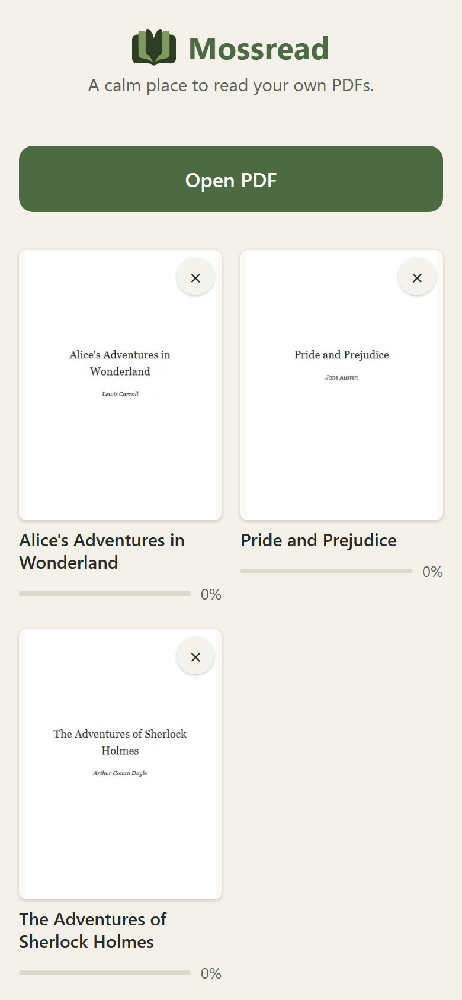
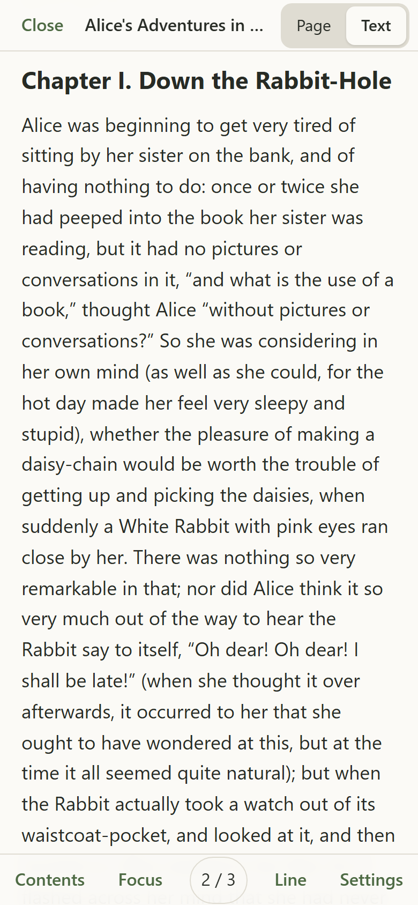
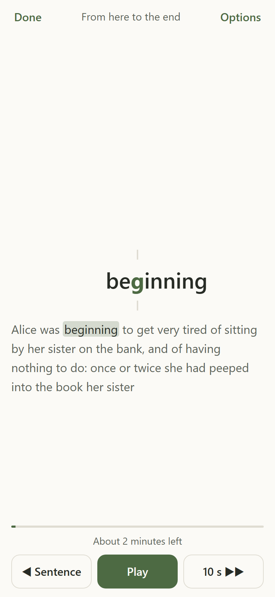
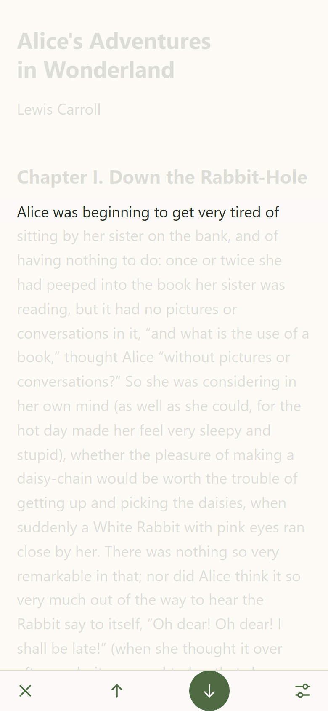

<h1> Mossread</h1>

A calm, ad-free reader for your own PDFs. It runs entirely in your browser:
your files are never uploaded, and there is no account and no tracking.

**Live:** https://mossread.vercel.app

<p>
  
  
  
  
</p>

## What it does

- **Page view.** The PDF as it was printed. Zoom, go to a page, open the table
  of contents, select and copy text.
- **Text view.** The same pages as plain, flowing text that fits the screen.
  Choose the font, text size, line spacing, theme (light, sepia, dark, black
  or your own colours), column width, margins and alignment. Switching between
  the two views keeps your place.
- **Focus.** Words appear one at a time, or a few at a time, in the same spot,
  at the speed you set. Pause to see the whole sentence, step back a sentence
  or skip ahead. You can also keep the words before and after in view,
  faded on either side.
- **Line focus.** One line is lit and the rest of the page is dimmed. Move
  line by line yourself or let it move on at your pace. One line or three.
- **Read with.** Select a passage in either view and read just that part in
  Focus or Line focus. Both can also start from where you are, or cover a
  page, a range of pages or a chapter.
- **Library.** Books you open stay on your device and reopen where you left
  them. You can see how much space they take and delete any of them.
- **Offline and installable.** After the first visit Mossread opens without a
  connection. Add it to your home screen to use it like an app. On Android,
  installed Mossread shows up when you share a PDF from another app.

Mossread is designed for phones first and works on desktop browsers too. So far
it has been tried on Android and on desktop; it has not yet been tried on an
iPhone.

## Privacy

PDFs are opened and kept in your browser's own storage on your device. The
site's Content Security Policy blocks requests to any other server, so the
page has no way to send your files anywhere. There are no analytics and no
cookies.

## Open source, made to be forked

Mossread is free and open source under the [MIT License](LICENSE).

You can fork it, change the reading screens, add your own reading modes and
host your own copy, for personal or commercial use, without asking. The only
condition is to keep the copyright and license notice with the code.

## Run it locally

```sh
npm install
npm run dev         # http://localhost:5173
npm run dev:phone   # also reachable from a phone on the same network
npm run build       # static output in dist/
npm run preview     # serves the build, with offline support
```

The build is a plain static site, so any static host works. Offline support
only runs on the built site over https (or on localhost), not on the dev server.

## Translations

Every piece of interface text lives in `src/locales/<language>/common.json`.
English is the reference catalogue. To add a language, copy the `en` folder,
rename it (for example `de` or `pt-BR`) and translate the values. It is picked
up automatically and loaded only when someone uses it.

## License

[MIT](LICENSE). The screenshots use the opening pages of public domain books.
